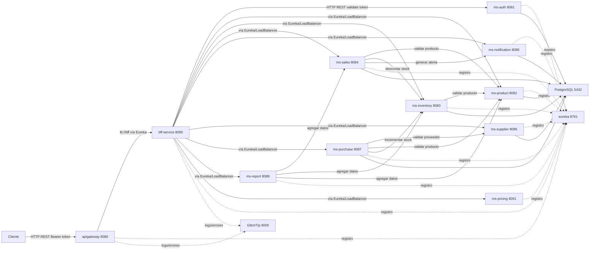

# Sistema de Gestión Integral para Ferretería

## Descripción General

El presente proyecto consiste en el desarrollo de una solución basada en arquitectura de microservicios para una ferretería de barrio que actualmente realiza la mayoría de sus procesos de forma manual mediante registros en papel.

La ferretería enfrenta diversos problemas operativos derivados de la falta de digitalización de sus procesos, afectando la gestión de inventario, ventas y control de productos.

La solución propuesta permite digitalizar y automatizar las operaciones críticas del negocio, centralizando la información y mejorando la trazabilidad, disponibilidad y confiabilidad de los datos.

---

# Problemática del Negocio

## Situación Actual 

Actualmente la ferretería administra:

- Inventario en papel.
- Registro de productos manual.
- Ventas registradas en cuadernos.
- Control de stock manual.
- Seguimiento de ventas manual.
- Alertas inexistentes para stock bajo.

### Problemas Detectados

- Pérdida frecuente de documentos físicos.
- Errores de digitación.
- Desconocimiento del stock real disponible.
- Falta de trazabilidad de ventas.
- Lentitud en la atención al cliente.
- Dificultad para detectar productos con stock bajo.
- Riesgo de vender productos sin existencia.
- Falta de información para la toma de decisiones.

---

# Solución Propuesta 

Se desarrolló una plataforma basada en microservicios que permite:

- Gestionar productos digitalmente.
- Controlar inventario en tiempo real.
- Registrar ventas automáticamente.
- Descontar stock de forma automática.
- Generar alertas de stock bajo.
- Consultar información centralizada.
- Proteger accesos mediante JWT.
- Facilitar la escalabilidad futura del sistema.

---

# Objetivos

## Objetivo General

Diseñar e implementar una plataforma de gestión integral para una ferretería de barrio utilizando arquitectura de microservicios.

## Objetivos Específicos

- Digitalizar el catálogo de productos.
- Automatizar el control de inventario.
- Registrar ventas de manera segura.
- Implementar autenticación basada en JWT.
- Generar alertas de stock bajo.
- Centralizar la información del negocio.
- Mejorar la trazabilidad de las operaciones.

---

# Arquitectura del Sistema

El sistema utiliza una arquitectura de microservicios, permitiendo que cada componente tenga una responsabilidad específica y pueda evolucionar de forma independiente.

## Ventajas

- Escalabilidad.
- Mantenibilidad.
- Bajo acoplamiento.
- Despliegue independiente.
- Mejor organización del dominio de negocio.
- Facilidad de integración futura.

---

# Arquitectura Implementada

## API Gateway

Puerto: **8080** — único punto de entrada público al sistema.

Responsabilidades:

- Único punto de acceso externo (todo el resto de los servicios es interno a la red Docker).
- Reenvía (forward) toda solicitud hacia el BFF (`lb://bff`) resuelto vía Eureka.
- No implementa lógica de negocio ni seguridad propia: es un forwarder puro. La validación de JWT y la orquestación siguen siendo responsabilidad exclusiva del BFF.

---

## Eureka Server

Puerto: **8761** (dashboard de registro/descubrimiento)

Responsabilidades:

- Registro y descubrimiento de servicios (Service Discovery).
- Todos los demás componentes (Gateway, BFF y los 9 microservicios) se registran en Eureka al arrancar.
- La comunicación entre BFF↔microservicios y microservicio↔microservicio se resuelve por nombre lógico (`http://ms-xxx`) vía Eureka + Spring Cloud LoadBalancer, en lugar de URLs fijas.

---

## BFF (Backend For Frontend)

Puerto: **8090** (interno; ya no es el punto de entrada público — ese rol lo cumple el API Gateway en el 8080)

Responsabilidades:

- Validación de JWT (contra ms-auth) antes de reenviar cualquier solicitud.
- Orquestación de los 9 microservicios de negocio.
- Exposición de endpoints al cliente a través del Gateway.
- Resuelve cada microservicio vía Eureka + `@LoadBalanced RestClient.Builder` (nombres lógicos, no URLs fijas).

---

## ms-auth

Puerto: **8081**

Responsabilidades:

- Registro de usuarios.
- Inicio de sesión.
- Generación de JWT.
- Validación de tokens.

---

## ms-product

Puerto: **8082**

Responsabilidades:

- Gestión de productos.
- Catálogo de productos.
- Búsqueda por nombre.
- Búsqueda por categoría.

---

## ms-inventory

Puerto: **8083**

Responsabilidades:

- Gestión de stock.
- Control de bodegas.
- Ajuste de inventario.
- Detección de stock bajo.

---

## ms-sales

Puerto: **8084**

Responsabilidades:

- Registro de ventas.
- Consulta de ventas.
- Integración con inventario.
- Integración con productos.
- Generación de alertas.

---

## ms-notification

Puerto: **8085**

Responsabilidades:

- Registro de notificaciones.
- Consulta de alertas.
- Gestión de estados de lectura.

---

## ms-supplier

Puerto: **8086**

Responsabilidades:

- CRUD de proveedores (nombre, RUT, contacto, estado).

---

## ms-purchase

Puerto: **8087**

Responsabilidades:

- Registro y gestión de órdenes de compra a proveedores.
- Al confirmar una orden, incrementa el stock correspondiente en ms-inventory (simétrico a cómo ms-sales lo descuenta).
- Valida proveedor (ms-supplier) y productos (ms-product) antes de crear la orden.

---

## ms-report

Puerto: **8088** — **sin base de datos** (servicio de agregación pura, solo lectura)

Responsabilidades:

- Resumen de ventas, top de productos, valorización de inventario y alertas de stock bajo.
- Agrega información en tiempo real desde ms-sales, ms-inventory y ms-product vía Eureka; no persiste ningún dato propio.

---

## ms-pricing

Puerto: **8091** — **sin base de datos** (servicio de cálculo puro)

Responsabilidades:

- Cálculo de descuentos por volumen/categoría sobre un precio y cantidad recibidos como entrada.
- Reglas de descuento configurables vía `application.properties`, sin persistencia.

---

# Persistencia de Datos

El proyecto implementa el patrón:

## Database per Service

Cada microservicio que requiere persistencia posee su propia base de datos lógica. Los servicios puramente de agregación/cálculo (`ms-report`, `ms-pricing`) no tienen base de datos, evitando duplicar información que ya vive en otro microservicio.

| Microservicio | Base de Datos |
|-------------|-------------|
| ms-auth | auth_db |
| ms-product | product_db |
| ms-inventory | inventory_db |
| ms-sales | sales_db |
| ms-notification | notification_db |
| ms-supplier | supplier_db |
| ms-purchase | purchase_db |
| ms-report | *(sin base de datos)* |
| ms-pricing | *(sin base de datos)* |

Todas las bases de datos se ejecutan sobre una única instancia PostgreSQL para simplificar el despliegue académico mediante Docker.

---

# Puertos del Sistema

| Servicio | Puerto | Expuesto al host |
|-----------|---------|---------|
| API Gateway | 8080 | Sí (único punto de entrada público) |
| Eureka Server | 8761 | Sí (dashboard) |
| BFF | 8090 | No (interno) |
| ms-auth | 8081 | No (interno) |
| ms-product | 8082 | No (interno) |
| ms-inventory | 8083 | No (interno) |
| ms-sales | 8084 | No (interno) |
| ms-notification | 8085 | No (interno) |
| ms-supplier | 8086 | No (interno) |
| ms-purchase | 8087 | No (interno) |
| ms-report | 8088 | No (interno) |
| ms-pricing | 8091 | No (interno) |
| PostgreSQL | 5432 | Sí (desarrollo) |
| GlitchTip | 8000 | Sí (UI de observabilidad) |

---

# Diagrama C2 – Arquitectura General



---

# Diagrama C3 – Arquitectura Interna del BFF

```mermaid
graph LR
    User[Cliente]
    Gateway[apigateway 8080]
    JwtFilter[JwtAuthenticationFilter]
    SecurityConfig[SecurityConfig]
    RestClientConfig[RestClientConfig]
    GlobalExceptionHandler[GlobalExceptionHandler]

    AuthController[AuthController]
    HealthController[HealthController]
    ProductController[ProductController]
    InventoryController[InventoryController]
    SalesController[SalesController]
    NotificationController[NotificationController]
    SupplierController[SupplierController]
    PurchaseController[PurchaseController]
    ReportController[ReportController]
    PricingController[PricingController]

    AuthClient[AuthClient]
    OtherClients[...otros 8 Clients]

    MSAuth[ms-auth]
    OtherMS[...otros 8 microservicios]

    User -->|HTTP REST Bearer token| Gateway
    Gateway -->|lb://bff vía Eureka| JwtFilter
    JwtFilter --> SecurityConfig
    JwtFilter -->|validate token| AuthClient
    AuthClient -->|POST /auth/validate vía Eureka| MSAuth

    JwtFilter --> AuthController
    JwtFilter --> ProductController
    JwtFilter --> InventoryController
    JwtFilter --> SalesController
    JwtFilter --> NotificationController
    JwtFilter --> SupplierController
    JwtFilter --> PurchaseController
    JwtFilter --> ReportController
    JwtFilter --> PricingController

    ProductController --> OtherClients
    InventoryController --> OtherClients
    SalesController --> OtherClients
    NotificationController --> OtherClients
    SupplierController --> OtherClients
    PurchaseController --> OtherClients
    ReportController --> OtherClients
    PricingController --> OtherClients
    OtherClients --> OtherMS

    AuthController -.-> GlobalExceptionHandler
    ProductController -.-> GlobalExceptionHandler
    InventoryController -.-> GlobalExceptionHandler
    SalesController -.-> GlobalExceptionHandler
    NotificationController -.-> GlobalExceptionHandler
    SupplierController -.-> GlobalExceptionHandler
    PurchaseController -.-> GlobalExceptionHandler
    ReportController -.-> GlobalExceptionHandler
    PricingController -.-> GlobalExceptionHandler

    RestClientConfig -.->|@LoadBalanced| AuthClient
    RestClientConfig -.->|@LoadBalanced| OtherClients
```

> Nota: cada uno de los 9 microservicios sigue el mismo patrón Controller → BffService → Client que `AuthController`/`AuthClient`; se omiten del diagrama por brevedad (ver tabla de controladores más abajo).

---

# Explicación Técnica de los Diagramas C2 y C3

## Diagrama C2: Arquitectura General del Sistema

### Componentes Principales

**1. Capa Cliente**
- Usuario o cliente (Postman, Frontend, etc.)
- Se comunica únicamente con el BFF mediante HTTP REST
- Envía token JWT en el header `Authorization: Bearer <token>`

**2. Capa API Gateway (Puerto 8080)**
El API Gateway es el **único punto de entrada público** al sistema:
- Reenvía toda solicitud entrante hacia `lb://bff`, resuelto vía Eureka
- No implementa lógica de negocio ni seguridad propia (forwarder puro)
- Expone Actuator (`/actuator/health`) para healthchecks de Docker

**3. Capa BFF (Puerto 8090, interno)**
El BFF conserva toda la lógica de orquestación y seguridad:
- Realiza validación de JWT antes de procesar cualquier solicitud
- Orquesta llamadas a los 9 microservicios de negocio, resolviéndolos vía Eureka + `@LoadBalanced RestClient.Builder`
- Centraliza el manejo de errores (GlobalExceptionHandler)
- Transforma respuestas y normaliza formatos
- Expone documentación Swagger

**4. Capa de Microservicios**
Nueve microservicios independientes con responsabilidades específicas, todos registrados en Eureka:
- **ms-auth (8081):** Gestión de autenticación y generación de JWT
- **ms-product (8082):** Catálogo de productos
- **ms-inventory (8083):** Control de inventario
- **ms-sales (8084):** Registro y consulta de ventas
- **ms-notification (8085):** Sistema de alertas
- **ms-supplier (8086):** Gestión de proveedores
- **ms-purchase (8087):** Órdenes de compra a proveedores
- **ms-report (8088):** Reportería agregada, sin base de datos
- **ms-pricing (8091):** Cálculo de descuentos, sin base de datos

**5. Capa de Persistencia**
Una única instancia PostgreSQL (5432) con patrón **Database per Service**:
- Cada microservicio que requiere persistencia tiene su propia base de datos lógica
- ms-report y ms-pricing no persisten datos propios (agregación/cálculo puro)
- Garantiza independencia y bajo acoplamiento
- Simplifica el despliegue académico mediante Docker

**6. Observabilidad**
- **Eureka (8761):** registro y descubrimiento de servicios
- **GlitchTip (8000):** captura centralizada de errores/logs (self-hosted), integrado en Gateway, BFF y los 9 microservicios

### Flujos de Comunicación

**Flujo Cliente → Gateway → BFF → Microservicio:**
```
Usuario → apigateway:8080 (Bearer Token) → lb://bff (Eureka) → bff:8090 → ms-xxx (Eureka) → PostgreSQL
```

**Coordinación entre Microservicios (Orquestación, todo vía Eureka):**
```
ms-sales → ms-product (validar producto)
ms-sales → ms-inventory (descontar stock)
ms-sales → ms-notification (generar alerta)
ms-inventory → ms-product (validar producto)
ms-purchase → ms-supplier (validar proveedor)
ms-purchase → ms-product (validar producto)
ms-purchase → ms-inventory (incrementar stock al confirmar)
ms-report → ms-sales / ms-inventory / ms-product (agregación de solo lectura)
```

---

## Diagrama C3: Arquitectura Interna del BFF

### Capas de Procesamiento

**1. Capa de Seguridad (🔐)**
La seguridad se implementa en dos niveles:

- **SecurityFilterChain:**
  - Configura la cadena de filtros de Spring Security
  - Define rutas públicas y protegidas
  - Configura CORS, CSRF, sesiones stateless

- **JwtAuthenticationFilter:**
  - Ejecuta **PRIMERO** en la cadena de filtros
  - Extrae el token del header `Authorization: Bearer <token>`
  - Llama a `AuthClient.validateToken(token)`
  - Valida contra `ms-auth:8081/auth/validate`
  - Si es válido, configura el `SecurityContext`
  - Si falla, rechaza la solicitud (401 Unauthorized)

**Rutas Públicas (sin JWT):**
- `/api/auth/login` - Autenticación
- `/api/auth/register` - Registro
- `/health` - Health check
- `/api-docs/**` - Documentación
- `/swagger-ui/**` - Swagger UI

**2. Capa de Controladores (🎮)**
Diez controladores REST exponen los servicios del BFF:

| Controlador | Ruta | Responsabilidad |
|---|---|---|
| AuthController | `/api/auth` | Login, registro (sin JWT) |
| HealthController | `/health` | Health check (sin JWT) |
| ProductController | `/api/products` | Consulta y CRUD de productos |
| InventoryController | `/api/inventory` | Gestión de inventario |
| SalesController | `/api/sales` | Registro y consulta de ventas |
| NotificationController | `/api/notifications` | Consulta de alertas |
| SupplierController | `/api/suppliers` | Gestión de proveedores |
| PurchaseController | `/api/purchases` | Órdenes de compra |
| ReportController | `/api/reports` | Reportería agregada |
| PricingController | `/api/pricing` | Cálculo de descuentos |

**3. Capa de Servicios (⚙️)**
Nueve servicios orquestadores que **delegan** a los clientes HTTP:

- **AuthBffService:** Delega a AuthClient
- **ProductBffService:** Delega a ProductClient
- **InventoryBffService:** Delega a InventoryClient
- **SalesBffService:** Delega a SalesClient
- **NotificationBffService:** Delega a NotificationClient
- **SupplierBffService:** Delega a SupplierClient
- **PurchaseBffService:** Delega a PurchaseClient
- **ReportBffService:** Delega a ReportClient
- **PricingBffService:** Delega a PricingClient

> **Nota:** El BFF NO contiene lógica de negocio compleja. Es un patrón de **orquestación simple** donde el servicio delega directamente al cliente. La lógica compleja (validar producto, descontar stock, generar alertas) reside en los microservicios.

**4. Capa de Clientes HTTP (🌐)**
Nueve clientes HTTP comunican con los microservicios usando RestClient:

```java
@Component
public class AuthClient {
    private final RestClient restClient;
    
    public AuthClient(@Qualifier("authRestClient") RestClient restClient) {
        this.restClient = restClient;
    }
    
    public ValidateTokenResponseDto validateToken(String token) {
        return restClient.post().uri("/auth/validate")
                .body(new ValidateTokenRequestDto(token))
                .retrieve().body(ValidateTokenResponseDto.class);
    }
}
```

Cada cliente está calificado con un bean específico, resuelto vía Eureka (no por puerto fijo):
- `@Qualifier("authRestClient")` → ms-auth
- `@Qualifier("productRestClient")` → ms-product
- `@Qualifier("inventoryRestClient")` → ms-inventory
- `@Qualifier("salesRestClient")` → ms-sales
- `@Qualifier("notificationRestClient")` → ms-notification
- `@Qualifier("supplierRestClient")` → ms-supplier
- `@Qualifier("purchaseRestClient")` → ms-purchase
- `@Qualifier("reportRestClient")` → ms-report
- `@Qualifier("pricingRestClient")` → ms-pricing

**5. Configuración (⚙️)**
RestClientConfig crea un `RestClient` por microservicio, resuelto vía Eureka + Spring Cloud LoadBalancer (nombres lógicos, no URLs fijas):

```java
@Configuration
public class RestClientConfig {

    @Bean
    @LoadBalanced
    public RestClient.Builder loadBalancedRestClientBuilder() {
        return RestClient.builder();
    }

    @Bean("authRestClient")
    public RestClient authRestClient(RestClient.Builder loadBalancedRestClientBuilder) {
        return loadBalancedRestClientBuilder.clone().baseUrl("http://ms-auth").build();
    }
    // ... un bean análogo por cada uno de los 9 microservicios
    // (ms-product, ms-inventory, ms-sales, ms-notification,
    //  ms-supplier, ms-purchase, ms-report, ms-pricing)
}
```

El nombre lógico (`http://ms-auth`, `http://ms-product`, etc.) corresponde al `spring.application.name` con el que cada microservicio se registra en Eureka; Spring Cloud LoadBalancer resuelve la instancia real detrás de escena.

**6. Manejo de Errores (❌)**
GlobalExceptionHandler captura excepciones a nivel global:

```java
@RestControllerAdvice
public class GlobalExceptionHandler {
    @ExceptionHandler(UnauthorizedException.class)
    public ResponseEntity<Map<String, Object>> handleUnauthorized(UnauthorizedException ex)
    
    @ExceptionHandler(RestClientResponseException.class)
    public ResponseEntity<Map<String, Object>> handleRestClientResponse(RestClientResponseException ex)
    
    @ExceptionHandler(Exception.class)
    public ResponseEntity<Map<String, Object>> handleGeneral(Exception ex)
}
```

---

### Flujo Completo de una Request Protegida

```
1. Cliente envía: POST /api/sales con Authorization: Bearer <token>
   └─→ apigateway:8080 recibe la solicitud y la reenvía a lb://bff (Eureka)

2. bff:8090 recibe la solicitud reenviada por el Gateway

3. SecurityFilterChain intercepta
   └─→ Ordena los filtros de seguridad

4. JwtAuthenticationFilter ejecuta PRIMERO
   ├─→ Extrae token del header
   ├─→ Llama a AuthClient.validateToken(token)
   ├─→ AuthClient → POST ms-auth/auth/validate (resuelto vía Eureka)
   ├─→ Si válido: configura SecurityContext
   └─→ Si inválido: rechaza (401)

5. SalesController recibe la solicitud
   └─→ Llama a SalesBffService.register(dto)

6. SalesBffService.register()
   └─→ Llama a SalesClient.register(dto)

7. SalesClient realiza HTTP REST
   └─→ POST ms-sales/sales con los datos (resuelto vía Eureka)

8. ms-sales procesa:
   ├─→ Valida producto → Llama a ms-product (Eureka)
   ├─→ Descuenta stock → Llama a ms-inventory (Eureka)
   └─→ Genera alerta → Llama a ms-notification (Eureka)

9. Respuesta retorna:
   ms-sales → SalesClient → SalesBffService → SalesController → apigateway → Cliente

10. Si ocurre excepción:
    └─→ GlobalExceptionHandler la captura y transforma a JSON
```

---

### Patrón Arquitectónico: API Gateway + BFF + Service Layer

**API Gateway (apigateway, 8080):**
- Único punto de entrada público
- Forwarder puro hacia `lb://bff` (sin lógica propia)

**BFF (bff-service, 8090, interno):**
- Validación centralizada de JWT
- Orquestación y enrutamiento a los 9 microservicios vía Eureka
- Manejo de errores global
- Transformación de respuestas

**Service Layer:**
- Orquestación simple
- Delegación al cliente HTTP
- No contiene lógica de negocio compleja

**Client Layer:**
- Comunicación con microservicios
- Manejo de protocolos HTTP
- Serialización/deserialización JSON

---

# Flujo de Negocio

## Registro de Usuario

1. Usuario solicita registro.
2. BFF envía solicitud a ms-auth.
3. ms-auth almacena usuario.
4. Se confirma el registro.

---

## Inicio de Sesión

1. Usuario envía credenciales.
2. ms-auth valida credenciales.
3. Se genera JWT.
4. JWT es retornado al usuario.

---

## Creación de Producto

1. Usuario autenticado crea producto.
2. BFF reenvía solicitud.
3. ms-product almacena producto.

---

## Registro de Inventario

1. Usuario crea inventario.
2. ms-inventory valida producto.
3. Se almacena stock inicial.

---

## Registro de Venta

1. Usuario registra venta.
2. BFF envía solicitud a ms-sales.
3. ms-sales consulta ms-product.
4. ms-sales solicita descuento de stock a ms-inventory.
5. ms-inventory actualiza existencias.
6. Si corresponde, ms-sales genera notificación.
7. ms-notification registra la alerta.
8. Se confirma la venta.

---

# Seguridad

## JWT (JSON Web Token)

El sistema utiliza JWT para proteger los endpoints.

Proceso:

1. Usuario realiza login.
2. ms-auth genera token JWT.
3. Cliente almacena token.
4. Cliente envía token mediante:

```http
Authorization: Bearer <token>
```

5. El BFF valida el token mediante ms-auth.
6. Si el token es válido, la solicitud continúa.

---

# Swagger/OpenAPI

Cada microservicio dispone de documentación Swagger.

## URLs

Swagger se expone en cada servicio de forma interna (puerto no publicado al host excepto el propio Gateway); para pruebas locales fuera de Docker cada servicio puede levantarse individualmente en su puerto:

| Servicio | Swagger (local, fuera de Docker) |
|-----------|-----------|
| BFF | http://localhost:8090/swagger-ui.html |
| ms-auth | http://localhost:8081/swagger-ui.html |
| ms-product | http://localhost:8082/swagger-ui.html |
| ms-inventory | http://localhost:8083/swagger-ui.html |
| ms-sales | http://localhost:8084/swagger-ui.html |
| ms-notification | http://localhost:8085/swagger-ui.html |
| ms-supplier | http://localhost:8086/swagger-ui.html |
| ms-purchase | http://localhost:8087/swagger-ui.html |
| ms-report | http://localhost:8088/swagger-ui.html |
| ms-pricing | http://localhost:8091/swagger-ui.html |

---

## Uso de Swagger

1. Ejecutar Login.
2. Copiar JWT.
3. Presionar botón **Authorize**.
4. Ingresar:

```text
Bearer eyJ...
```

5. Ejecutar endpoints protegidos.

---

# Tecnologías Utilizadas

- Java 21
- Spring Boot 3.3.4
- Spring Cloud 2023.0.x (Eureka, Gateway, LoadBalancer)
- Spring Security
- Spring Validation
- PostgreSQL 16
- Docker
- Docker Compose
- OpenAPI / Swagger
- Lombok
- Gradle
- JWT
- Flyway
- GlitchTip (self-hosted, compatible con Sentry SDK) + SLF4J/Logback

---

# Docker

El ecosistema completo (Eureka, API Gateway, BFF, los 9 microservicios, PostgreSQL y GlitchTip) se levanta con un único `docker-compose.yml` en la raíz del proyecto.

## Construcción

```bash
docker compose build
```

## Levantar Contenedores

```bash
docker compose up -d
```

Todo el ecosistema queda operativo ejecutando únicamente este comando (sin pasos manuales adicionales), gracias a los healthchecks y `depends_on` configurados entre servicios.

## Verificar Estado

```bash
docker compose ps
```

## Detener Servicios

```bash
docker compose down
```

## Observabilidad (GlitchTip)

GlitchTip se levanta junto con el resto del stack (self-hosted, con su propia base de datos PostgreSQL y Redis) y queda disponible en http://localhost:8000. Por defecto la variable `GLITCHTIP_DSN` viaja vacía (no hay DSN hardcodeado): para capturar errores es necesario crear un proyecto en la UI de GlitchTip, copiar el DSN generado y exportarlo como variable de entorno `GLITCHTIP_DSN` antes de levantar el stack. Mientras tanto, los logs de todos los servicios (Gateway, BFF y los 9 microservicios) se siguen mostrando normalmente por consola vía SLF4J.

---

# Casos de Uso

## Registrar Usuario

Permite crear una nueva cuenta dentro del sistema.

## Gestionar Productos

Permite crear, modificar, consultar y eliminar productos.

## Gestionar Inventario

Permite controlar existencias y stock mínimo.

## Registrar Venta

Permite generar una venta y descontar inventario automáticamente.

## Consultar Notificaciones

Permite visualizar alertas generadas por el sistema.

---

# Beneficios Obtenidos

- Eliminación de registros manuales.
- Menor riesgo de pérdida de información.
- Control de stock en tiempo real.
- Mejor trazabilidad de ventas.
- Mayor velocidad de atención.
- Información centralizada.
- Escalabilidad futura.
- Arquitectura moderna basada en microservicios.

---


# Ejecución de Pruebas

Cada uno de los 12 proyectos Gradle (`eureka`, `apigateway`, `bff`, `ms-auth`, `ms-product`, `ms-inventory`, `ms-sales`, `ms-notification`, `ms-supplier`, `ms-purchase`, `ms-report`, `ms-pricing`) incluye su propia suite de pruebas y su propio wrapper de Gradle.

Para ejecutar las pruebas de un proyecto, ubicarse en su carpeta y ejecutar:

```bash
./gradlew.bat clean test
```

Ejemplo:

```bash
cd ms-auth
./gradlew.bat clean test
```

Este comando se debe repetir dentro de cada carpeta (`eureka`, `apigateway`, `bff`, `ms-auth`, `ms-product`, `ms-inventory`, `ms-sales`, `ms-notification`, `ms-supplier`, `ms-purchase`, `ms-report`, `ms-pricing`) para validar el proyecto completo.

---

# Tipos de Pruebas

El proyecto implementa distintos niveles de pruebas siguiendo la arquitectura por capas de cada microservicio:

- **ApplicationTests:** Verifica que el contexto de Spring Boot de la aplicación cargue correctamente.
- **ControllerTest:** Prueba los endpoints REST de la capa de controladores, validando códigos de respuesta y contratos de entrada/salida.
- **ServiceTest:** Prueba la lógica de negocio de la capa de servicios de forma aislada, utilizando mocks para sus dependencias.
- **RepositoryTest:** Prueba la capa de persistencia (JPA Repositories) contra una base de datos real en memoria.
- **DTO ValidationTest:** Prueba las validaciones de los DTOs de entrada (anotaciones de Bean Validation).

---

# Cobertura de Código

El proyecto utiliza **JaCoCo** para medir la cobertura de código de las pruebas en cada uno de los 12 proyectos, con un umbral mínimo del **40%** verificado automáticamente mediante la tarea `jacocoTestCoverageVerification` (falla el build si no se cumple). La clase `*Application` de cada proyecto se excluye del cálculo de cobertura, ya que su único método (`main`) no es representativo de lógica de negocio.

Al ejecutar `./gradlew.bat clean test`, JaCoCo genera automáticamente el reporte de cobertura y valida el umbral mínimo.

Los reportes HTML se generan en la siguiente ruta dentro de cada microservicio:

```
build/reports/jacoco/test/html/index.html
```

---

# Tecnologías de Testing

- JUnit 5
- Mockito
- Spring Boot Test
- H2 (base de datos en memoria para pruebas)
- Flyway (migraciones de base de datos en entorno de pruebas)
- JaCoCo (cobertura de código)

---

# Arquitectura de Testing

Las pruebas siguen la misma separación por capas que la arquitectura de cada microservicio:

- **ControllerTest** valida la capa REST de forma aislada, simulando las solicitudes HTTP y verificando las respuestas, delegando la lógica de negocio a mocks de la capa de servicios.
- **ServiceTest** valida la lógica de negocio de forma aislada, utilizando Mockito para simular las dependencias (repositorios y clientes externos).
- **RepositoryTest** valida la capa de persistencia ejecutando las pruebas contra una base de datos **H2** en memoria, sobre la cual **Flyway** aplica las migraciones definidas para el esquema de cada microservicio, garantizando que las pruebas reflejen la estructura real de la base de datos.

De esta forma, cada capa se prueba de manera independiente, manteniendo bajo acoplamiento entre las pruebas y permitiendo detectar errores en el nivel correspondiente de la arquitectura.

# Conclusión

La implementación del Sistema de Gestión Integral para Ferretería representa una modernización significativa de los procesos operativos del negocio. La migración desde registros manuales en papel hacia una plataforma digital permite mejorar la eficiencia, reducir errores humanos y aumentar la disponibilidad de información crítica para la toma de decisiones.

La adopción de una arquitectura basada en microservicios facilita la separación de responsabilidades, permitiendo que cada componente evolucione de forma independiente y mantenga un bajo nivel de acoplamiento. Asimismo, la incorporación de mecanismos de autenticación mediante JWT garantiza la protección de los recursos del sistema y el acceso controlado a la información.

El uso de Docker simplifica el despliegue y la portabilidad de la solución, mientras que Swagger proporciona documentación interactiva que facilita las pruebas y el mantenimiento de las APIs. Adicionalmente, la estrategia Database per Service mejora la independencia de los microservicios y fortalece la escalabilidad del sistema.

En conjunto, la solución desarrollada permite transformar un proceso tradicional basado en papel en una plataforma tecnológica moderna, capaz de mejorar la gestión del inventario, automatizar ventas, generar alertas oportunas y proporcionar una base sólida para futuras mejoras y crecimiento del negocio.

---
